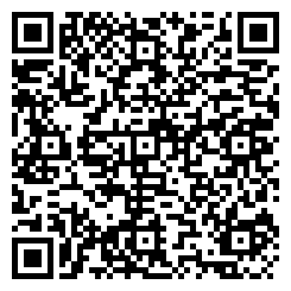
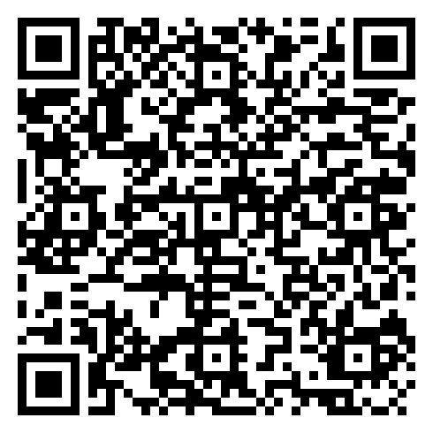
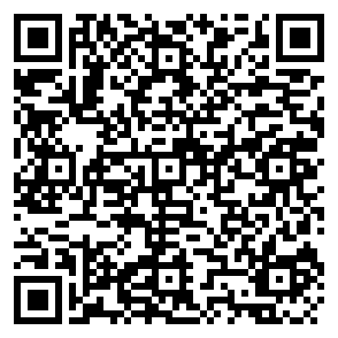
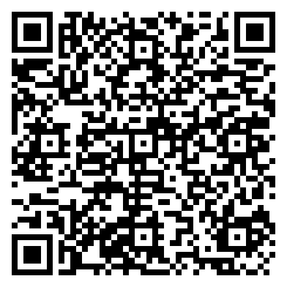
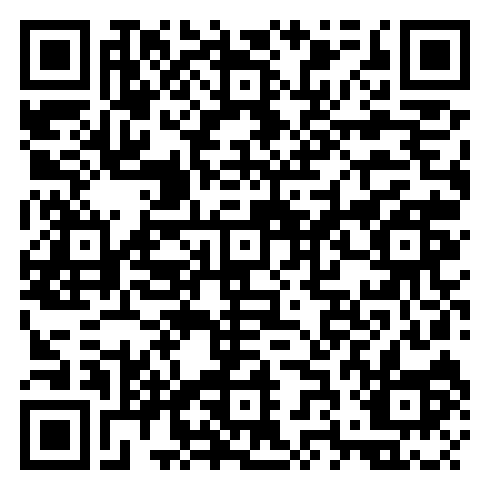

# CS23331 — Design and Analysis of Algorithms Laboratory

**Rajalakshmi Engineering College (Autonomous)**  
**Department of Artificial Intelligence and Machine Learning**  
**Course Code:** CS23331 | **Course Name:** Design and Analysis of Algorithms Laboratory  

---

## 📚 Laboratory Experiments Overview

| Week | Experiment Title | Key Problems Covered | Document Link | QR Code |
| :--- | :--- | :--- | :---: | :---: |
| **Week 1** | Complexity Analysis (Counter Method) | Finding time complexity using counter method and step counting in iterative loops (Problems 1–5) | [📄 Week_1.pdf](./Week_1.pdf) |  |
| **Week 2** | Greedy Algorithms | Coin Change Problem, Greedy Cookies, Burger Problem, Maximum Array Sum, Minimum Product of Array Elements | [📄 Week_2.pdf](./Week_2.pdf) |  |
| **Week 3** | Divide and Conquer Algorithms | Count Zeros in a Given Array, Majority Element, Finding Floor Value, Two Elements Sum to Target, Quick Sort Implementation | [📄 Week_3.pdf](./Week_3.pdf) |  |
| **Week 4** | Dynamic Programming | Playing with Numbers, Chessboard Problem, Longest Common Subsequence (LCS), Longest Non-Decreasing Subsequence | [📄 Week_4.pdf](./Week_4.pdf) |  |
| **Week 5** | Search & Array Optimization | Finding Duplicates ($O(n^2)$ & $O(n)$ space/time tradeoffs), Intersection of Sorted Arrays, Pairs with Given Difference $k$ | [📄 Week_5.pdf](./Week_5.pdf) |  |

---

## 📑 Final Continuous Evaluation Lab Sheet

The complete continuous evaluation record sheet is available as:
- **[📄 daa final lab sheet.pdf](./daa%20final%20lab%20sheet.pdf)**

### Sheet Structure:
1. **Page 1:** Official Laboratory Record Note Book Cover Sheet with college header, course title, and student metadata fields.
2. **Page 2:** Continuous Evaluation Sheet formatted into three columns:
   - **Column 1:** Name of the week, title, and topic breakdown.
   - **Column 2:** High-resolution QR code linking directly to each week's laboratory PDF in this repository.
   - **Column 3:** Space for Date, Marks (/100), and Faculty Evaluation Signature.

---

## 🛠️ Reproduction & PDF Generation

To regenerate the QR codes and the 2-page evaluation sheet:
```bash
python generate_lab_sheet.py
```
Outputs `daa final lab sheet.pdf` ready for printing and submission.
